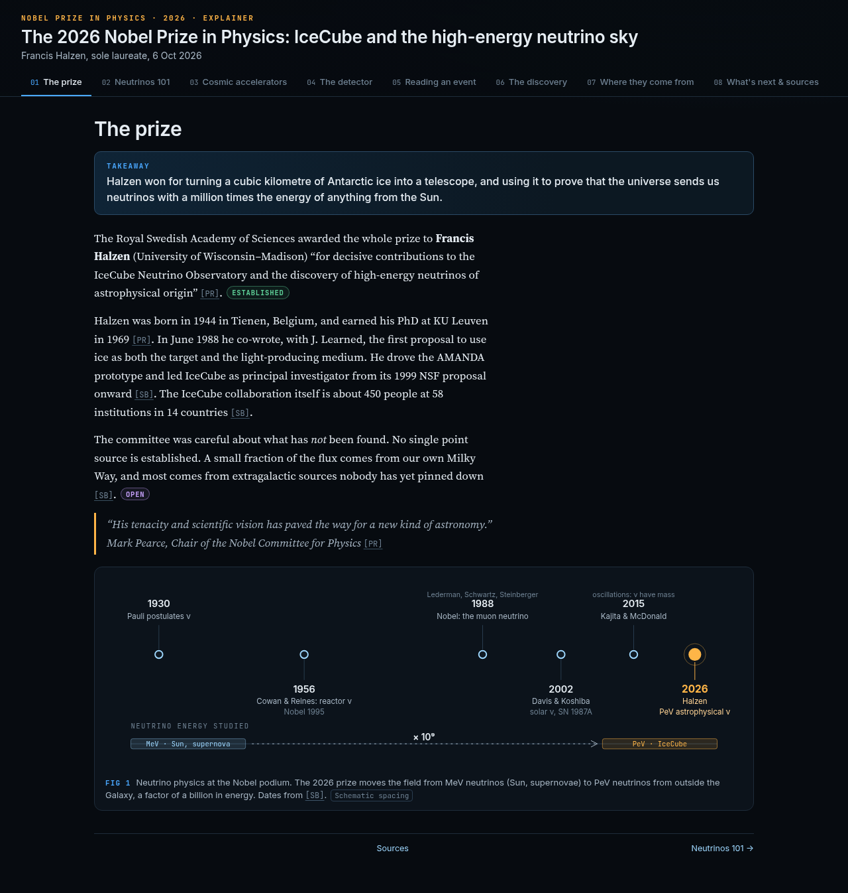

# The 2026 Nobel Prize in Physics: IceCube and the high-energy neutrino sky

**Live page: https://az9713.github.io/grokbots-nobel-physics-2026-explainer/**

## Summary

This is an interactive, single-page explainer of the 2026 Nobel Prize in Physics. The prize went to Francis Halzen for his decisive contributions to the IceCube Neutrino Observatory, a cubic kilometre of Antarctic ice turned into a telescope, and for the discovery of high-energy neutrinos of astrophysical origin. It is written for technically trained readers who don't have a background in particle physics or astrophysics: the jargon is explained before it is used, and each claim is marked as established or open.

## The 8 tabs

1. The prize
2. Neutrinos 101
3. Cosmic accelerators
4. The detector
5. Reading an event
6. The discovery
7. Where they come from
8. What's next & sources

## Files

| File | What it is |
| --- | --- |
| `index.html` | The explainer that GitHub Pages serves (self-contained HTML, CSS and JS) |
| `nobel-physics-2026-explainer.html` | The same page under its original filename |
| `research.md` | Source research and citations |
| `narrative.md` | The narrative script the page was built from |
| `qa/REPORT.md` | The end-to-end QA report |

## How it was made

- **Rex Research** researched the prize from primary sources.
- **Sommer Summary** wrote the narrative.
- **Frank Frontend** designed and built the page.
- **Tess Tester** ran the QA pass on desktop and mobile across all 8 tabs.
- **Devin Development** published it to GitHub Pages.
- **Chief GrokBot** orchestrated the work.

## Sources

The main source is the Nobel Committee for Physics' [scientific background](https://www.nobelprize.org/uploads/2026/10/advanced-physicsprize2026.pdf). Its [popular science background](https://www.nobelprize.org/uploads/2026/10/popular-physicsprize2026.pdf) and the [press release](https://www.nobelprize.org/prizes/physics/2026/press-release/) were also used. The full citations are in `research.md` and in the page's last tab.
