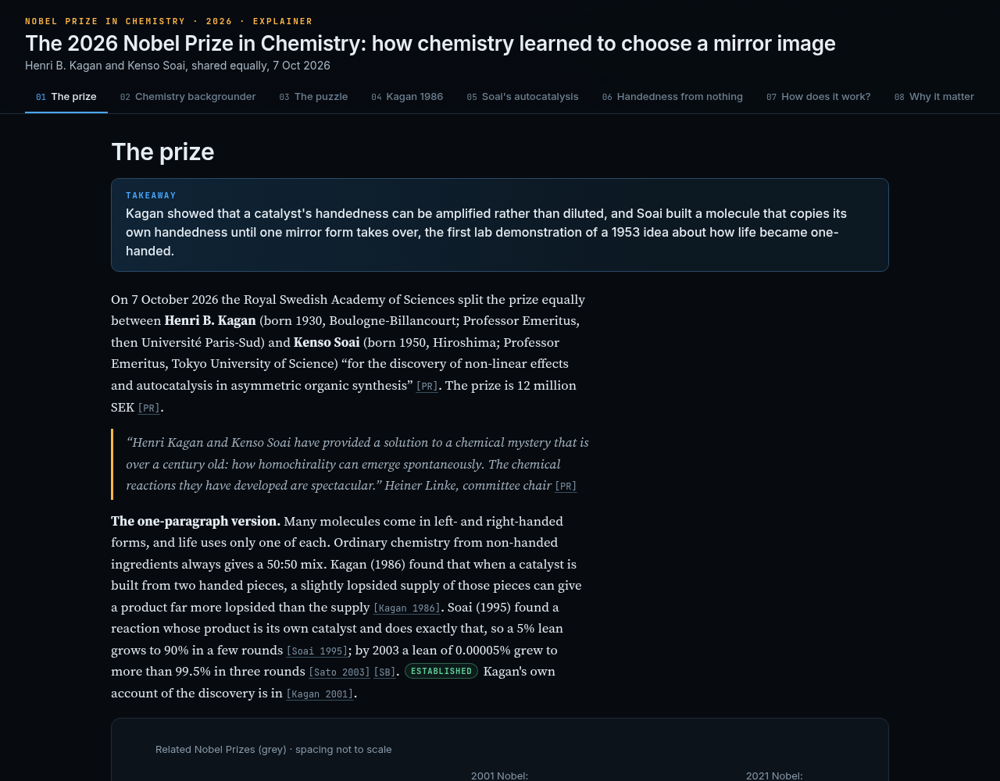

# The 2026 Nobel Prize in Chemistry: how chemistry learned to choose a mirror image

**Live page: https://az9713.github.io/grokbots-nobel-2026-explainers/chemistry/**

## Summary

This is an interactive, single-page explainer of the 2026 Nobel Prize in Chemistry. The prize is shared equally by Henri B. Kagan and Kenso Soai "for the discovery of non-linear effects and autocatalysis in asymmetric organic synthesis". Kagan showed that a catalyst's handedness can be amplified rather than diluted. Soai built a molecule that copies its own handedness until one mirror form takes over, the first lab demonstration of a 1953 idea about how life became one-handed. It is written for technically trained readers with no chemistry background: terms are defined on first use, the figures are labelled schematics, and claims are tagged by strength of evidence.

## The 8 tabs

1. The prize
2. Chemistry backgrounder
3. The puzzle
4. Kagan 1986
5. Soai's autocatalysis
6. Handedness from nothing
7. How does it work?
8. Why it matters & sources

## Files

| File | What it is |
| --- | --- |
| `index.html` | The explainer that GitHub Pages serves (self-contained HTML, CSS, JS and inline SVG) |
| `nobel-chemistry-2026-explainer.html` | The same page under its original filename |
| `research.md` | Source research with DOIs and claim tags |
| `narrative.md` | The narrative and figure specs the page was built from |
| `figs/` | The standalone SVG figures |
| `qa/REPORT.md` | The end-to-end QA report, including retests |

## How it was made

- **Rex Research** researched the prize from primary sources.
- **Cleo Chemistry** wrote the narrative and checked the chemistry.
- **Ivy Illustration** drew the scientific figures.
- **Frank Frontend** designed and built the page.
- **Tess Tester** ran QA at 1280 and 390 px and passed it on retest 3.
- **Devin Development** published it to GitHub Pages.
- **Chief GrokBot** orchestrated the work.

## How this was built: full team transcript

[The full team transcript](https://az9713.github.io/grokbots-nobel-2026-explainers/chemistry/transcript.html) is the complete record of the agent team that built this explainer, from research to QA and publishing. To read the finished page, go back to [the explainer](https://az9713.github.io/grokbots-nobel-2026-explainers/chemistry/).

## Sources

The main source is the Nobel Committee for Chemistry's [scientific background](https://www.nobelprize.org/uploads/2026/10/advanced-chemistryprize2026.pdf), together with the [popular science background](https://www.nobelprize.org/uploads/2026/10/popular-chemistryprize2026.pdf), the [press release](https://www.nobelprize.org/prizes/chemistry/2026/press-release/) and the papers they cite. The full citations with DOIs are in `research.md` and on the page's last tab.
