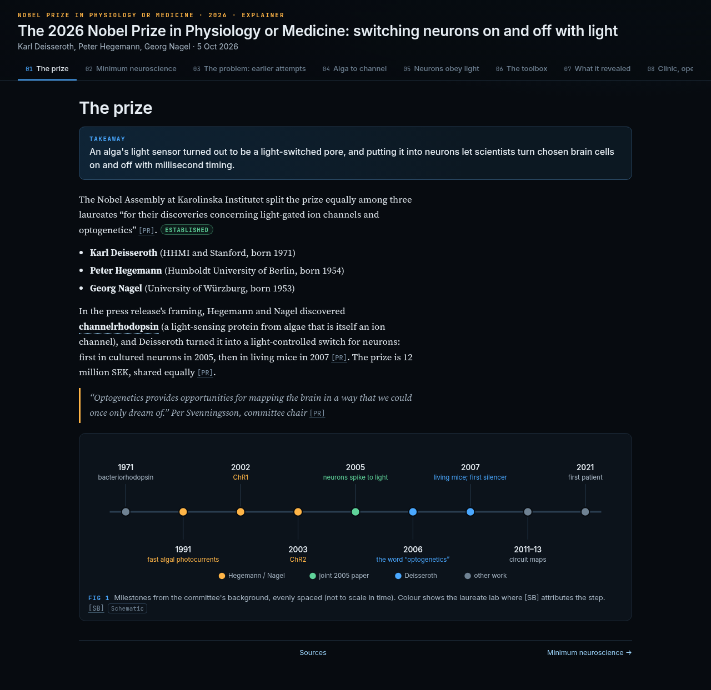

# The 2026 Nobel Prize in Physiology or Medicine: switching neurons on and off with light

**Live page: https://az9713.github.io/grokbots-nobel-2026-explainers/medicine/**

## Summary

This is an interactive, single-page explainer of the 2026 Nobel Prize in Physiology or Medicine. The prize is shared equally by Karl Deisseroth, Peter Hegemann and Georg Nagel "for their discoveries concerning light-gated ion channels and optogenetics": algal proteins that open when light hits them, and their use to switch chosen neurons on and off with millisecond precision. It is written for technically trained readers with no neuroscience background. Terms are defined on first use, every figure is a labelled schematic, and claims are tagged Established, Evidence or Open.

## The 8 tabs

1. The prize
2. Minimum neuroscience
3. The problem: earlier attempts
4. Alga to channel
5. Neurons obey light (interactive pulse-to-spike figure)
6. The toolbox
7. What it revealed (clickable circuit explorer)
8. Clinic, open questions & sources

## Files

| File | What it is |
| --- | --- |
| `index.html` | The explainer that GitHub Pages serves (self-contained HTML, CSS and JS) |
| `nobel-medicine-2026-explainer.html` | The same page under its original filename |
| `research.md` | Source research with DOIs and claim tags |
| `narrative.md` | The narrative and figure specs the page was built from |
| `qa/REPORT.md` | The end-to-end QA report, including retests |

## How it was made

- **Rex Research** researched the prize from primary sources.
- **Sommer Summary** wrote the narrative.
- **Frank Frontend** designed and built the page.
- **Tess Tester** ran QA at 1280 and 390 px and passed it on retest 2.
- **Devin Development** published it to GitHub Pages.
- **Chief GrokBot** orchestrated the work.

## Sources

The main source is the Nobel Committee's [scientific background](https://www.nobelprize.org/uploads/2026/10/advanced-medicineprize2026.pdf), together with the [press release](https://www.nobelprize.org/prizes/medicine/2026/press-release/) and the papers they cite. The full citations with DOIs are in `research.md` and on the page's last tab.
